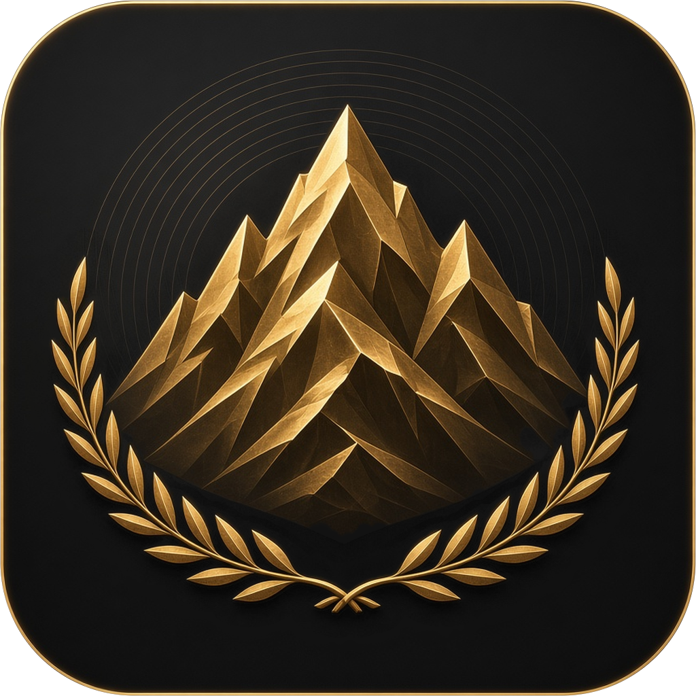
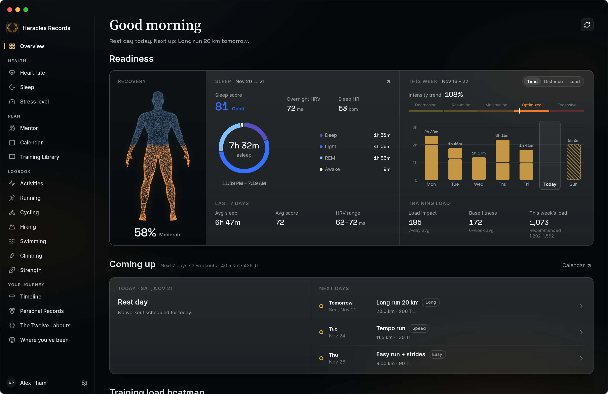
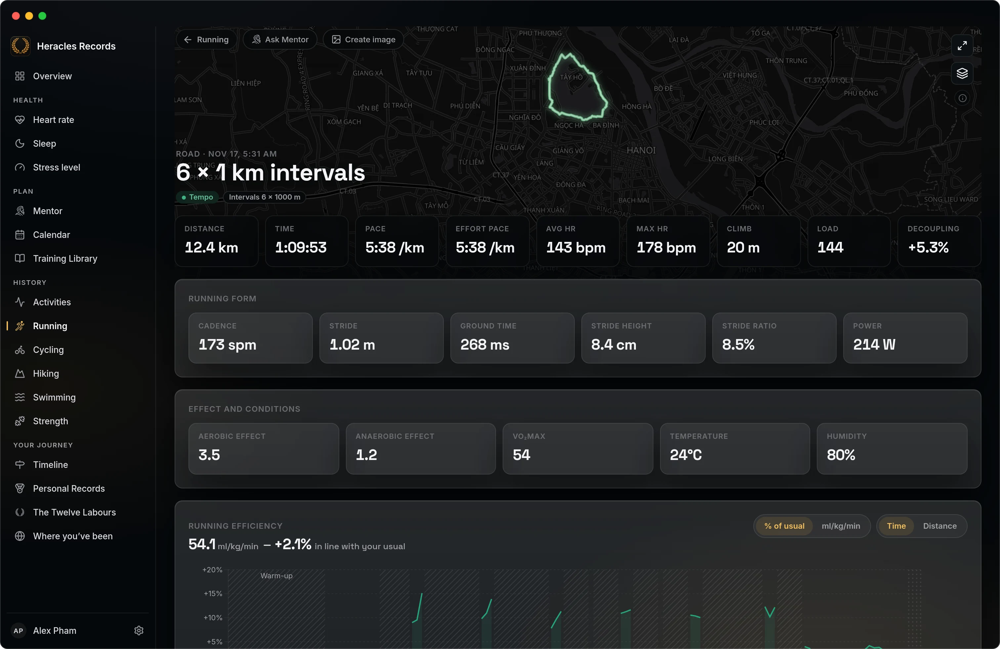
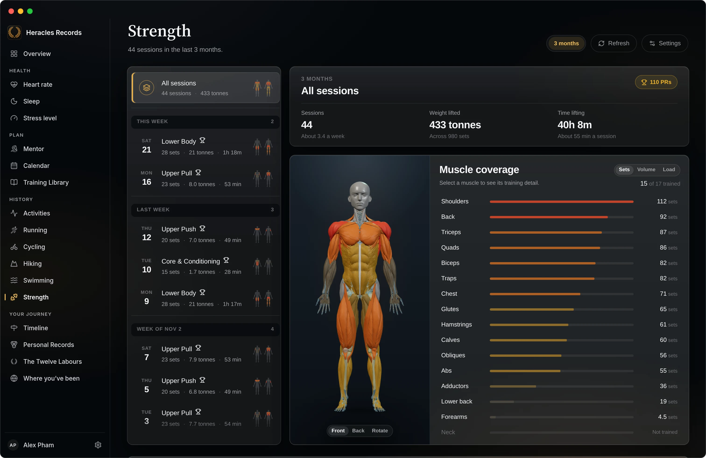
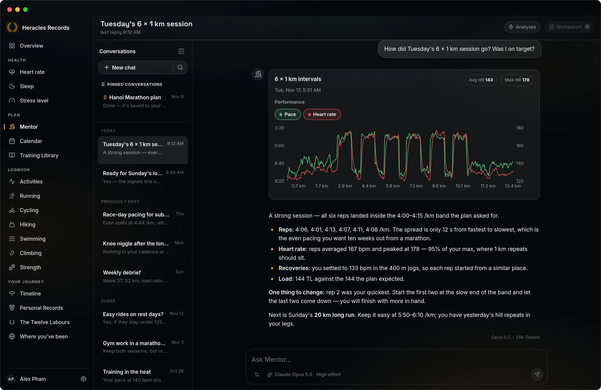
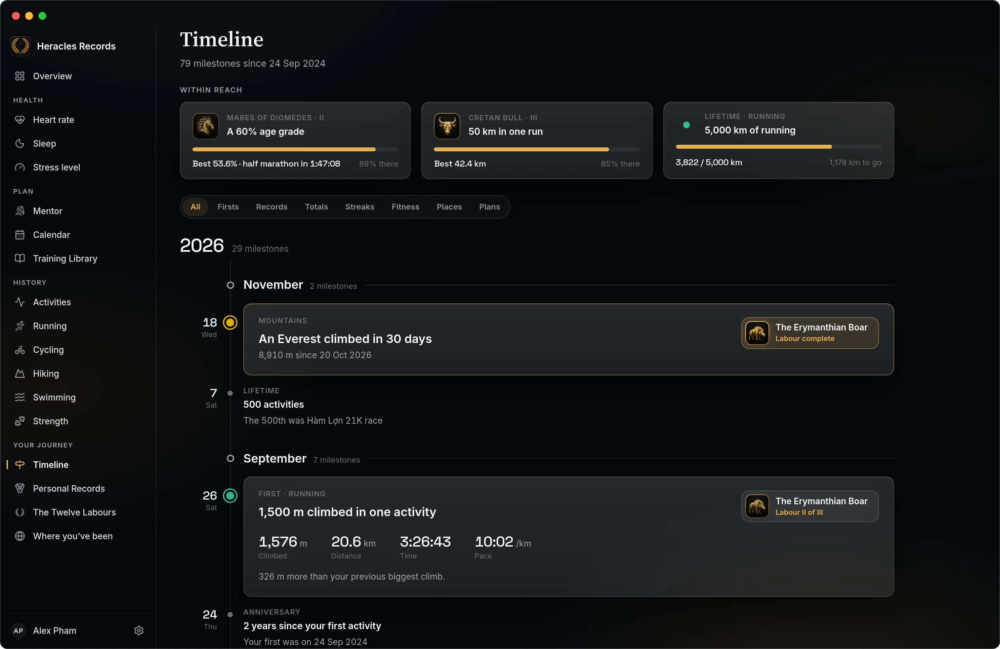

<p align="center">
  
</p>

<h1 align="center">Heracles Records</h1>

<p align="center">
  <strong>Training records, analytics &amp; AI - alongside your COROS data.</strong><br />
  <em>Every session a record. Every record a labour.</em>
</p>

<p align="center">
  A free desktop app for COROS athletes: every session read in depth,<br />
  an AI mentor that has read all of it, and a hall for every record you set along the way.
</p>

<p align="center">
  <a href="https://heraclesrecords.com"><strong>heraclesrecords.com</strong></a>
  &nbsp;·&nbsp; <a href="https://heraclesrecords.com/guide/">Guide</a>
  &nbsp;·&nbsp; <a href="https://heraclesrecords.com/changelog/">Changelog</a>
  &nbsp;·&nbsp; <a href="https://heraclesrecords.com/privacy.html">Privacy</a>
</p>

<p align="center">
  <a href="https://github.com/quochungse/HeraclesRecords/releases/latest"></a>
  <a href="https://github.com/quochungse/HeraclesRecords/releases"></a>
</p>

<!-- release:badges:start -->
<p align="center">
  <a href="https://github.com/quochungse/HeraclesRecords/releases/download/v1.6.1/HeraclesRecords-1.6.1-arm64.dmg"></a>
  <a href="https://github.com/quochungse/HeraclesRecords/releases/download/v1.6.1/HeraclesRecords-1.6.1-x64.dmg"></a>
  <a href="https://github.com/quochungse/HeraclesRecords/releases/download/v1.6.1/HeraclesRecords-Setup-1.6.1.exe"></a>
  <a href="https://github.com/quochungse/HeraclesRecords/releases/download/v1.6.1/HeraclesRecords-1.6.1.AppImage"></a>
  <a href="https://github.com/quochungse/HeraclesRecords/releases/download/v1.6.1/HeraclesRecords-1.6.1.deb"></a>
</p>
<!-- release:badges:end -->



> [!NOTE]
> An independent project, **not made, endorsed or supported by COROS**. It reads your training through your own COROS account, so it works with any COROS watch that syncs there: PACE, APEX, VERTIX, NOMAD and the rest.

## What's inside

<table>
  <tr>
    <td width="50%" valign="top">
      
      <p><strong>Every session, read in depth.</strong> Runs, rides, hikes, swims and climbs, with every channel the watch recorded and charts that answer a question.</p>
    </td>
    <td width="50%" valign="top">
      
      <p><strong>Strength, counted properly.</strong> COROS strength sessions and Hevy workouts together, with every set on the muscles it worked and scored from what you lifted, on the same scale as your runs.</p>
    </td>
  </tr>
  <tr>
    <td width="50%" valign="top">
      
      <p><strong>A mentor that has read your training.</strong> Ask about a session or a week, or draft a plan with it, on your ChatGPT account, a Claude subscription, an API key or a local model.</p>
    </td>
    <td width="50%" valign="top">
      
      <p><strong>Hall of Records.</strong> Every first, record and streak, kept month by month, and twelve labours to reach.</p>
    </td>
  </tr>
</table>

Also inside: Sleep, Heart rate and Stress level · a Calendar and Training Library that save to your COROS account · an Exercises Library with the muscles every movement really works · Where you've been · thirteen languages · sync through your own Google Drive. **Every screen in depth at [heraclesrecords.com](https://heraclesrecords.com).**

## Download

<!-- release:downloads:start -->
| Platform | Installer | Size |
| --- | --- | --- |
| **macOS** · Apple Silicon (M1 and later) | [HeraclesRecords-1.6.1-arm64.dmg](https://github.com/quochungse/HeraclesRecords/releases/download/v1.6.1/HeraclesRecords-1.6.1-arm64.dmg) | 176 MB |
| **macOS** · Intel | [HeraclesRecords-1.6.1-x64.dmg](https://github.com/quochungse/HeraclesRecords/releases/download/v1.6.1/HeraclesRecords-1.6.1-x64.dmg) | 181 MB |
| **Windows** 10 / 11 · 64-bit | [HeraclesRecords-Setup-1.6.1.exe](https://github.com/quochungse/HeraclesRecords/releases/download/v1.6.1/HeraclesRecords-Setup-1.6.1.exe) | 168 MB |
| **Linux** · AppImage, any distribution | [HeraclesRecords-1.6.1.AppImage](https://github.com/quochungse/HeraclesRecords/releases/download/v1.6.1/HeraclesRecords-1.6.1.AppImage) | 183 MB |
| **Linux** · Debian / Ubuntu (.deb) | [HeraclesRecords-1.6.1.deb](https://github.com/quochungse/HeraclesRecords/releases/download/v1.6.1/HeraclesRecords-1.6.1.deb) | 140 MB |

Version 1.6.1 · [What's new](https://github.com/quochungse/HeraclesRecords/releases/tag/v1.6.1) · [All releases](https://github.com/quochungse/HeraclesRecords/releases). The app tells you when a new version is out.
<!-- release:downloads:end -->

<details>
<summary><strong>First launch</strong></summary>

- **macOS**: this build is not notarized yet. If macOS says it cannot check the app, open **System Settings → Privacy &amp; Security** and click **Open Anyway**. If it says the app is damaged, run `xattr -dr com.apple.quarantine "/Applications/Heracles Records.app"` in Terminal, then open it again.
- **Windows**: SmartScreen may warn about an unrecognised app. Click **More info → Run anyway**.
- **Linux**: make the AppImage executable (`chmod +x HeraclesRecords-*.AppImage`) and run it, or install the deb on Debian / Ubuntu (`sudo apt install ./HeraclesRecords-*.deb`).

You sign in with your COROS account. Mentor also needs an AI: your ChatGPT account, a Claude subscription, a Claude or OpenRouter API key, or a model running on your own computer.

</details>

## Your data stays yours

- Your training comes from your COROS account and stays on your computer. The app has no account of its own and the developer runs no servers.
- Back up everything to one file you keep, and restore it whenever you like.

## The story behind Heracles Records

Heracles Records began as a fork of CorosLink, a desktop companion for COROS watches. I wanted a full record of my training, analytics deeper than a summary screen and an AI mentor that reads all of it, so I rebuilt the app around that. If you are looking for music on your watch, offline maps, watch faces or gear tracking, **CorosLink** does those well and is the app to use.

## Support

- Found a bug or have an idea? [Open an issue](https://github.com/quochungse/HeraclesRecords/issues/new), or use **Settings → About → Report an issue** in the app.
- Questions about setup? The [guide](https://heraclesrecords.com/guide/) and its [FAQ](https://heraclesrecords.com/guide/faq) may already answer them.
- If the app helps your training, you can [buy me a coffee](https://buymeacoffee.com/quochungse).

<details>
<summary><strong>Build from source</strong></summary>

```sh
npm install
npm run rebuild   # rebuilds the SQLite module for Electron
npm run dev
```

Before submitting changes to Mentor (`coach` in the code), run `npm run check:coach`. It builds each target
once and runs the provider, runtime, settings and renderer checks. See
[Coach checks](docs/coach-checks.md) for coverage, logs and headless Linux setup.

</details>

## License

[MIT](LICENSE). Heracles Records is based on CorosLink by AtoZ, also MIT. Third-party software and fonts are credited in [THIRD_PARTY_NOTICES.md](THIRD_PARTY_NOTICES.md).

COROS is a trademark of COROS Wearables, Inc. It appears here only to say which watches and accounts the app works with.
